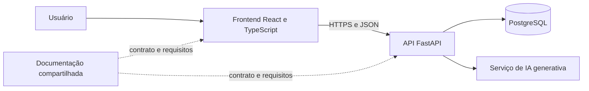

# Arquitetura e responsabilidades

A separação em três repositórios organiza o trabalho da equipe. O backend continua sendo um monólito modular, conforme o planejamento inicial.

## Backend

Valida entradas, aplica regras de negócio, persiste dados e centraliza a chamada ao provedor de IA. SQLAlchemy e Alembic estão previstos para modelos e migrações. A documentação interativa do FastAPI ficará em `/docs` quando a API for implementada.

## Frontend

Apresenta os módulos, coleta dados e consome a API. A chave de IA não é enviada ao navegador. A interface deve apresentar sugestões como apoio e permitir revisão.

## Dados principais

| Entidade | Relação principal |
| --- | --- |
| users | Registra ocorrências e recebe tarefas |
| equipment | Pode estar vinculado a várias ocorrências |
| occurrences | Pode apontar para um equipamento e originar tarefas |
| tasks | Vinculada a uma ocorrência e a um responsável |

O cadastro de usuários e a estratégia de autenticação precisam ser detalhados. Caso o MVP use responsáveis fictícios previamente cadastrados, isso deve ficar explícito na demonstração.

## Regras de integração

Salvar a ocorrência antes de chamar a IA. Uma falha no provedor não pode apagar o registro. A análise é uma operação separada e só produz sugestões; não cria tarefas nem executa ações físicas automaticamente.

Os indicadores do dashboard devem derivar do banco. Definir a transição entre status de tarefa e status de ocorrência antes da integração para evitar contagens inconsistentes.

## Hospedagem prevista

Frontend na Vercel, API no Render e PostgreSQL no Supabase são opções propostas no documento original. Os ambientes ainda não foram provisionados e os endereços ainda não existem. A configuração final será registrada depois da publicação.
