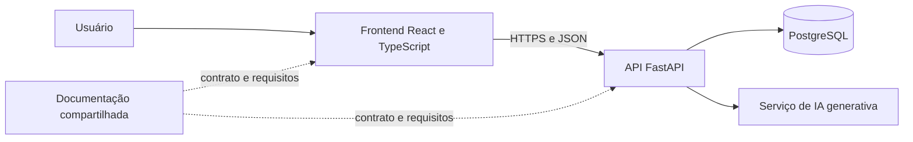

# Arquitetura e responsabilidades

A separação em três repositórios organiza o trabalho da equipe. O backend continua sendo um monólito modular, conforme o planejamento inicial.

## Backend

Valida entradas, aplica regras de negócio, persiste dados e centraliza a chamada ao provedor de IA. SQLAlchemy e Alembic implementam modelos e migrações; a documentação interativa está em `/docs`. A integração usa OpenAI Responses com saída estruturada validada, `store=false` e timeout configurável; a análise real ainda depende de saldo na conta da API.

## Frontend

Apresenta os módulos, coleta dados e consome a API. A chave de IA não é enviada ao navegador. A interface deve apresentar sugestões como apoio e permitir revisão.

## Dados principais

| Entidade | Relação principal |
| --- | --- |
| users | Catálogo de responsáveis por tarefas; não autentica nem identifica o autor de ocorrências |
| equipment | Pode estar vinculado a várias ocorrências |
| occurrences | Pode apontar para um equipamento e originar tarefas |
| tasks | Vinculada a uma ocorrência e a um responsável |
| occurrence_history | Eventos de criação, alteração, análise, revisão e status |

O MVP implementa cadastro e consulta de responsáveis fictícios. Papéis são descritivos, sem autorização. Login, identidade do autor e permissões ficam fora desta entrega; a demonstração deve explicitar essa limitação.

## Regras de integração

Salvar a ocorrência antes de chamar a IA. Uma falha no provedor não pode apagar o registro. A análise é uma operação separada e só produz sugestões; não cria tarefas nem executa ações físicas automaticamente.

Os indicadores derivam do banco. Iniciar tarefa põe ocorrência aberta em andamento. Concluir tarefa não resolve automaticamente a ocorrência; o operador resolve explicitamente após todas as tarefas concluídas. Histórico e alteração são gravados na mesma transação. Escritas de tarefa e encerramento bloqueiam a ocorrência para serializar decisões. O [contrato](contrato-api.md) detalha as regras.

## Hospedagem prevista

Frontend na Vercel, API no Render e PostgreSQL no Supabase são opções propostas no documento original. Os ambientes ainda não foram provisionados e os endereços ainda não existem. A configuração final será registrada depois da publicação.
